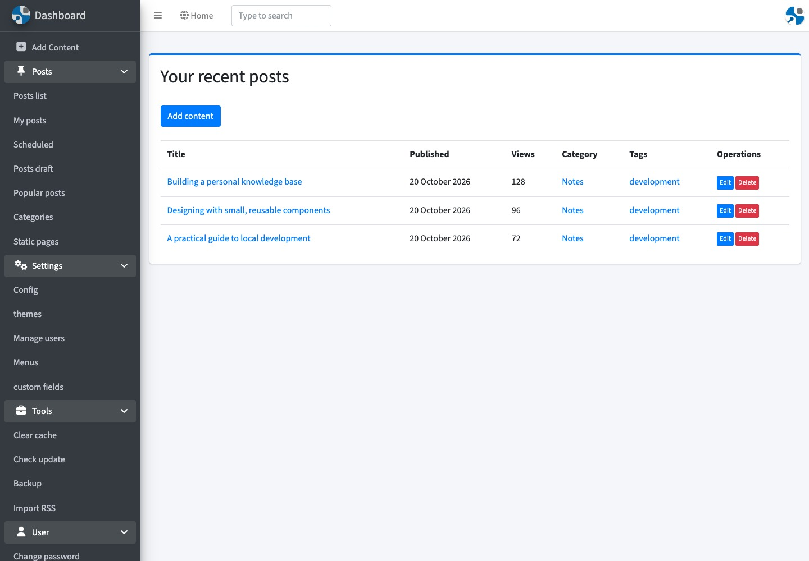
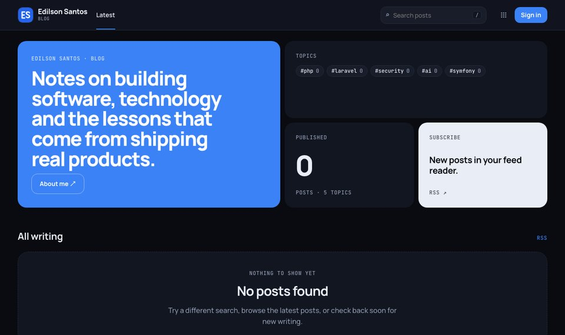
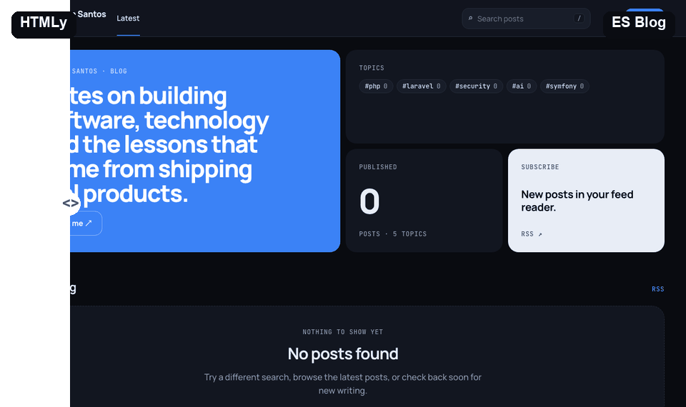

# ES Blog

<table>
  <tr>
    <th align="center"><a href="https://github.com/danpros/htmly">HTMLy</a> (original)</th>
    <th align="center">ES Blog (ours)</th>
  </tr>
  <tr>
    <td></td>
    <td></td>
  </tr>
  <tr>
    <td colspan="2" align="center"><br>
    <sub>Admin dashboard comparison: HTMLy on the left, ES Blog on the right. Both rendered locally with demo data. Before: <a href="https://github.com/danpros/htmly/tree/master/system/admin/views">upstream HTMLy admin templates</a> and assets (GPL-2.0 or later). After: the ES Blog Atlas admin dashboard.</sub></td>
  </tr>
</table>

A self-hosted blog and publishing workspace built on Symfony 7.4 LTS. Part of the ES apps alongside
[ES Portfolio](https://github.com/edilsonsantos-co-za/es-portfolio), ES Store (ES Marketplace) and ES Journal.
Source: [edilsonsantos-co-za/es-blog](https://github.com/edilsonsantos-co-za/es-blog).

> ES Blog started as a fork of [HTMLy](https://github.com/danpros/htmly) by
> [Danang Probo Sayekti (danpros)](https://github.com/danpros), licensed under GPL-2.0 (or later).
> [Version 1](https://github.com/edilsonsantos-co-za/edfolio-blog) (archived) kept HTMLy's codebase and moved
> storage to MySQL. Version 2, this repository, rewrites the application on Symfony and Doctrine while
> keeping HTMLy's content model: posts, pages, categories, tags, menus and authors. Credit for the original
> design goes to HTMLy; its licence and copyright files are preserved in `licenses/`.

## ES Blog vs HTMLy

This compares upstream HTMLy's current implementation with ES Blog's code and development history, not just
HTMLy's early releases. Search, RSS, roles, MFA and scheduled posts already exist upstream; their implementations
changed here rather than being invented by ES Blog.

| Area | HTMLy (original) | ES Blog |
|---|---|---|
| Storage | Databaseless: content files, INI user/config files and file-based indexes/cache | MySQL storage introduced in v1; Doctrine ORM entities and versioned schema migrations in v2 |
| Application framework | Procedural PHP routing and PHP view files | Symfony 7.4 LTS rewrite with controllers, services, dependency injection and Twig templates |
| Roles and permissions | Admin/editor roles and per-author ownership checks | Admin/editor/author hierarchy with Symfony voters for posts, users and configuration; publishing restricted to editors/admins |
| Admin workspace | Built-in dashboard, content editor, users, menus and configuration | Rewritten admin with an Atlas bento dashboard, linked status counts, most-read post, content management, nested menus and tabbed automation settings |
| Two-factor authentication | Google2FA-based MFA with an authenticator secret per user | scheb/2fa TOTP configuration and profile enable/disable screens; the active sign-in flow is SSO-only |
| Legacy passwords | Local password authentication and automatic hash upgrades | Legacy v1 SHA-512 password hasher and bcrypt migration support retained; no public password-login form in the current SSO-only setup |
| Single sign-on | Local username/password login, with optional MFA | DataSparkLab Logto integration using OpenID Connect authorization code + PKCE; verified email must match an existing blog account |
| Shared ES app sessions | Independent blog login/logout | Shared Logto sign-in across ES apps and parent-domain sign-out marker: signing out in another ES app ends the blog session on its next request |
| ES apps navigation | Blog navigation and user links | ES apps launcher and account menu in the public masthead and admin, linking ES Portfolio, ES Blog, ES Store and ES Journal |
| Atlas design | Selectable PHP themes | Built-in Atlas design coordinated with ES Portfolio; matching palette and typography for public, admin and auth templates |
| Colour mode | Theme-specific styling | Core Atlas and admin/auth styling are dark-only; the theme-mode toggle has been removed |
| Editorial homepage | Theme-defined post listings | Flat editorial bento: accent masthead, newest post lead, next two stories, topic pills, post count and RSS tile; deterministic generative covers when images are missing |
| Theme installation | Select themes already present under `themes/` | Admin marketplace picker or uploaded ZIP; SHA-256 file checks, Ed25519 signatures trusted through `config/theme-keys/`, app/version checks and installation under `var/themes/<id>/`; Atlas fallback and core-only admin templates |
| Search | Keyword search using a file-backed `content/data/search.json` index | Published-post search through Doctrine using SQL `LIKE` over title, body and description, exposed at `/search?q=...` |
| RSS | Built-in RSS, including author feeds | RSS 2.0 feed rebuilt at `/feed`, listing the latest 20 published posts with dated permalinks and an Atom self-link |
| Scheduled publishing | Scheduled posts published during application requests | Console publishing command and Messenger handler; worker runs the scheduler every five minutes between queue-consumer sessions |
| Background jobs | Request-driven publishing; no Symfony Messenger worker | Separate worker for scheduled publishing, LinkedIn shares, welcome mail, thumbnails and cache cleanup; Doctrine queue with retries and failed transport |
| Feed automation | Blog RSS/OPML output and content import tools | Feeder.co OPML subscription import, scheduled RSS/Atom fetching, topic scoring and review-first drafts; optional Claude drafting with attribution and GD-generated banners |
| Social publishing | Configurable social-profile links | Per-author LinkedIn and X OAuth connections, encrypted tokens and explicitly reviewed platform drafts/shares |
| Newsletters | No equivalent double-opt-in workflow | Separate article/product consent, confirmation, subscriber administration, preferences/unsubscribe and guarded queued campaigns |
| Docker and deployment | ZIP/online installer on a PHP web server | PHP 8.4/Apache image, local and production Compose stacks on shared `milkyway` services, persistent uploads/themes, startup migrations/queue setup/cache warmup and static-only uploads/assets |
| CI and releases | Upstream source distribution and releases | GitHub Actions SSH deployment on every push to `main`, building on the VPS; `VERSION`-checked tag workflow generates GitHub Releases (tests are run separately) |
| Automated tests | No root PHPUnit suite in the inspected upstream tree | PHPUnit service tests for theme signatures/installed-theme resolution, feed parsing, generated banners, LinkedIn token/client behavior and application versioning; Twig/container lint commands for development |

Upstream references: [README](https://github.com/danpros/htmly/blob/master/README.md),
[routes](https://github.com/danpros/htmly/blob/master/system/htmly.php),
[content/search/scheduling functions](https://github.com/danpros/htmly/blob/master/system/includes/functions.php),
[MFA settings](https://github.com/danpros/htmly/blob/master/system/admin/views/edit-mfa.html.php) and
[theme picker](https://github.com/danpros/htmly/blob/master/system/admin/views/theme.html.php).
ES Blog's implementations live in `src/`, `templates/`, `tests/`, `docker/` and `.github/workflows/`;
[its commit history](https://github.com/edilsonsantos-co-za/es-blog/commits/main/) records the changes.

More themes install under **Admin → Settings → Themes** without manual unzipping, file copying or cache clearing.
Production persists `var/themes/` in a volume. `THEME_STORE_URL` sets the store; `THEMES_ALLOW_UNSIGNED=1` bypasses
signature enforcement (not recommended: templates are code). Admin pages always use core templates; an unknown
or removed public theme falls back to Atlas.

## Quick start

Requirements: Docker with Compose.

```bash
cp .env.example .env.local        # set APP_SECRET, DATABASE_URL and LOGTO_* for your environment
docker compose up -d --build     # the entrypoint runs migrations and warms the cache
docker exec -it edfolio-v2-php php bin/console app:user:create admin you@example.com --role=admin
```

`app:user:create` asks for the password when `--password` is left out. Sign in at `/login`, which redirects
to Logto; the SSO account must have the same verified email as the blog user. Site settings live under
**Admin → Configuration**. Without Logto configuration, sign-in returns 503 rather than offering a password form.

The compose files publish no ports. The container joins an external Docker network and is meant to sit behind a
reverse proxy. See [docs/deployment.md](docs/deployment.md).

## Configuration

| Variable | Purpose |
|---|---|
| `APP_SECRET`, `DATABASE_URL` | Symfony secret and MySQL connection |
| `SITE_NAME`, `SITE_TITLE`, `SITE_URL` | Site name, authenticator label and URL defaults; public title/URL can be edited in the admin |
| `MAILER_DSN`, `MAILER_FROM`, `MESSENGER_TRANSPORT_DSN` | Mail transport and sender, and the queue. In production the deploy writes the mail settings from the `SMTP_*` GitHub secrets (see Email). |
| `LINKEDIN_CLIENT_ID`, `LINKEDIN_CLIENT_SECRET`, `LINKEDIN_REDIRECT_URI` | LinkedIn sharing. The redirect URI is `<site>/admin/linkedin/callback`. Optional `LINKEDIN_API_VERSION` (default `202608`). |
| `ANTHROPIC_API_KEY`, `AUTOMATION_AI_MODEL` | Claude for the feed digest (default model `claude-opus-5-5`). An API key from the Claude Console, billed separately from Claude Pro/Max subscriptions (see Claude below). Without a key, articles stay pending and no skeleton or copied posts are created. |
| `X_CLIENT_ID`, `X_CLIENT_SECRET`, `X_REDIRECT_URI` | X OAuth2 PKCE; register `<site>/admin/x/callback`. Requires a developer app with tweet-write access and the appropriate API plan. |
| `COFFEE_URL` | Buy Me a Coffee: header button, footer link, a support box at the end of every post and a line in newsletter emails (default `https://buymeacoffee.com/edilsonsantos`; blank hides them all). |
| `ES_DEVELOPERS_URL`, `UPWORK_URL`, `SUPPORT_URL` | Developers and optional verified public freelance/funding links. Blank optional URLs stay hidden; also editable in General settings. |
| `LOGTO_ENDPOINT`, `LOGTO_APP_ID`, `LOGTO_APP_SECRET` | Required for sign-in through Logto; set all three. |
| `LOGTO_INTERNAL_ENDPOINT` | Optional server-to-server Logto URL, for example a Docker service name |

To set up SSO, create a **Traditional web** application in Logto with the redirect URI `<site>/login/sso/callback`
and the post sign-out redirect URI `<site>/` (also allow `<site>/login` for failed sign-in recovery). Use
`DEFAULT_URI` for the registered public base URL. Only users who already exist in the blog can sign in: the
verified email must match their account. Production uses the shared DataSparkLab Logto service; signing out
through the ES apps menu also invalidates the other ES app sessions on their next request.

### Using your own Logto

Sign-in goes through [Logto](https://logto.io/), an open-source identity service. You need your own Logto instance:
either [Logto Cloud](https://cloud.logto.io/) (hosted, free tier available) or self-hosted Logto (open source, runs
in Docker). The [Logto documentation](https://docs.logto.io/) covers both. Then, in the Logto console:

1. **Applications → Create application → Traditional web.** Add the redirect URI `<site>/login/sso/callback` and the post
   sign-out redirect URI `<site>/`.
2. Copy the endpoint, app ID and app secret into `.env.local` (`LOGTO_ENDPOINT`, `LOGTO_APP_ID`, `LOGTO_APP_SECRET`).
   `LOGTO_INTERNAL_ENDPOINT` is optional, for when the app reaches Logto over a Docker network.
3. **Authorization → Roles → Create role** named `es-owner`, and assign it to your user. ES Blog asks for the
   `roles` scope and only lets in users who hold that role.
4. Create the matching blog user with `app:user:create` (see Quick start). The verified Logto email must match it.

Running several ES apps against the same Logto gives you single sign-on across them. Signing out in one app signs you
out of the others on their next request.

## Feed automation

**Admin → Maintenance → Feed Automation**

1. In Feeder.co, open **Library → Import & Export → Export to OPML** and upload the file (or add feeds one by one).
   Feeder has no public API, so re-import when you follow new feeds; feeds already in the list are skipped.
2. Under **Settings**, choose a **daily** or **weekly** digest and how many drafts it may write (up to five), set
   your topics (reader interests) and voice, then optionally enable **Run on a schedule**.
3. **Run automation** reads every feed, then writes the digest in two steps:
   - **Plan:** Claude sees every article collected since the last digest (title, publisher and a short excerpt) and groups
     the ones worth writing about by shared topic or concern: at most five topics, each with two or more articles.
   - **Write:** one draft per topic, consolidating all of its articles (up to 12) into one original post.

   Drafts appear in **Posts → Drafts**. Articles the digest left out are marked skipped, so the next digest starts
   fresh. If a topic fails, its articles stay pending for the next run.

Claude receives bounded excerpts and source metadata, never full copied articles. Each draft has an original
comparison of the sources, a description, tags, LinkedIn and X text, a 1200×630 banner drawn with GD (fonts in
`resources/fonts`, OFL) and a Sources list crediting every article. Used articles are never reused.

**All automation is review-only**: nothing is published or shared without you. The long-sentence copying check is
not plagiarism verification. Check the sources, attribution, factual claims and voice before publishing.

```bash
php bin/console app:feeds:import feeder.opml
php bin/console app:automation:run              # the digest, with the "drafts per digest" setting
php bin/console app:automation:run --posts=0    # only read feeds
```

The `worker` container runs `app:scheduler:tick` every five minutes (scheduled posts, plus the digest once a day or
once a week) between `messenger:consume` sessions. Keep it running for scheduled publishing and queued deliveries.

### Claude

The digest calls the Claude API with `ANTHROPIC_API_KEY`. **A Claude Pro or Max subscription does not include API
usage**, and Anthropic's terms don't allow routing a subscription login through an app like this one. The API is billed
separately, as prepaid credits:

1. Sign in at [platform.claude.com](https://platform.claude.com/) (the Claude Console) with your Claude account.
2. Under **Billing**, buy a small amount of credit and set a monthly spend limit.
3. Under **API keys**, create a key and set it as `ANTHROPIC_API_KEY` in the server's `.env`, then redeploy.

A daily digest makes one small planning call plus one call per draft. To spend less, set `AUTOMATION_AI_MODEL` to a
smaller model: Sonnet or Haiku instead of Opus. Each draft is reviewed before publishing anyway.

## Drafts and first publication

Drafts have **Blog / LinkedIn / Twitter** tabs. Edit and save each platform's text; publishing the blog does not
automatically share it. Use the separate reviewed Share action for each connected platform after publication.

**Preview on blog, LinkedIn and X** opens the reader layout without making a draft public or counting a view. At the
top it shows how the post will look on each platform: the blog card, the LinkedIn post with its link card and the X
post with its card, all with the post's thumbnail. **Generate new banner** draws a fresh 1200×630 thumbnail from the
saved title (the category or first tag becomes its label). Each new banner gets a new file name, so platforms that
cached the old image pick up the new one. Published posts carry absolute `og:image` and `twitter:card` tags, so
LinkedIn, X and other link previews show the thumbnail.

```bash
php bin/console app:post:welcome-draft
```

This prepares the launch article, which credits the open-source projects behind the ES apps and points to the
newsletter and the upcoming store. It also creates its banner and LinkedIn/X drafts. It always saves a **draft**:
it never publishes anything and never overwrites an existing article. The production deploy runs it, so the draft
appears under **Posts → Drafts** by itself. Publish it once email works, the repositories are public and you have
reviewed it.

## LinkedIn

1. At [linkedin.com/developers/apps](https://www.linkedin.com/developers/apps), **Create app**. LinkedIn requires a
   company page to associate the app with: create a simple one first if you don't have one.
2. **Products:** request **Share on LinkedIn** and **Sign In with LinkedIn using OpenID Connect** (both self-serve).
3. **Auth:** add the redirect URL `<site>/admin/linkedin/callback`, then copy the client ID and primary client secret.
4. Set `LINKEDIN_CLIENT_ID`, `LINKEDIN_CLIENT_SECRET` and `LINKEDIN_REDIRECT_URI` in the server's `.env` and redeploy.
5. In the admin, use **Connect LinkedIn** and approve with your own LinkedIn account.

Shares post as a link card with the post's banner uploaded as its thumbnail. Tokens are encrypted with a key derived from
`APP_SECRET`; the page shows expiry. Connect the actual post author's account and review its saved LinkedIn text
before sharing. Publication alone never sends to LinkedIn.

## X / Twitter

1. At [developer.x.com](https://developer.x.com/), sign up with the X account you'll post from and create a project
   and app. Posting through the API needs write access: check the portal's current plans and pricing, which X sets and
   changes, not ES Blog.
2. **User authentication settings:** type **Web App**, permissions **Read and write**, callback URI
   `<site>/admin/x/callback`, website `<site>`. Copy the **OAuth 2.0** client ID and client secret (not the API key).
3. Set `X_CLIENT_ID`, `X_CLIENT_SECRET` and `X_REDIRECT_URI` in the server's `.env` and redeploy.
4. In the admin, use **Admin → X → Connect** (it asks for `tweet.read`, `tweet.write`, `users.read` and
   `offline.access`).

X builds the link card from the post's `twitter:` tags, so shared posts show the banner.
Tokens are encrypted; refresh, disconnect and share history are supported. Text plus the final blog URL must fit
280 characters. Review the Twitter tab and explicitly share after the blog is live.

Queued shares hash the reviewed text and cancel if it changes before processing. A unique claim is saved before
calling either provider. Ambiguous timeouts/5xx remain pending/unknown rather than blindly reposting; review their
status in the integration page and reconcile the record only after checking the real account. There is no
automatic retry or unsafe “clear and resend” button for ambiguous attempts.

## Newsletters

Public `/newsletter` signup uses double opt-in. Article and product/release updates are separate choices; forking
a repository never subscribes anyone. Each subscriber has a private preferences/unsubscribe URL, and every email
includes unsubscribe headers/links. Confirmation and unsubscribe GETs do not change consent (email scanners are
safe); confirmations need POST + CSRF, and RFC8058 one-click unsubscribe POSTs are supported.

**Admin → Newsletter** lists subscribers and delivery settings. Delivery is disabled by default and refuses null
transports and the Mailtrap sandbox. Set up real email first (below), then enable delivery.
Initial live publication queues an article campaign; edits do not resend it, and scheduled posts cannot send early.
Workers recheck confirmation, current preferences and unsubscribe status at delivery.

```bash
php bin/console app:newsletter:product --subject="Reviewed release update" --body-file=release.txt
php bin/console app:newsletter:queue
```

Both default to dry-run. Real campaign/recovery queueing requires `--send --approve` and enabled, verified mail
configuration. Keep subject/body reviewed and only target the independently consented product audience.

## Email

Production mail comes from GitHub secrets on the repository (or the organisation). The deploy writes them into the
server's `.env`, and changing a secret and redeploying updates them:

| Secret | Example |
|---|---|
| `SMTP_HOST`, `SMTP_PORT` | `live.smtp.mailtrap.io`, `587` (Mailtrap Email Sending; any SMTP provider works) |
| `SMTP_USERNAME`, `SMTP_PASSWORD` | the provider's SMTP login (for Mailtrap Sending: `api` and an API token) |
| `MAIL_FROM_ADDRESS` | `hello@edilsonsantos.co.za`, an address on the domain you verified with the provider |

The same secrets serve ES Portfolio and ES Journal. Without them, the deploy falls back to the Mailtrap **sandbox**
(`MAILTRAP_USERNAME` and `MAILTRAP_PASSWORD`). The sandbox catches mail in a test inbox and delivers nothing, and it
never replaces real settings. With the provider, verify the sending domain (SPF, DKIM and DMARC DNS records), then
check delivery:

```bash
php bin/console app:mail:test you@example.com
```

It refuses the sandbox and null transports. Once the message lands in the inbox (not spam), enable the newsletter.

## Development

```bash
docker exec edfolio-v2-php php vendor/bin/phpunit
docker exec edfolio-v2-php php bin/console lint:twig templates
docker exec edfolio-v2-php php bin/console lint:container
```

Versioning is described in [docs/versioning.md](docs/versioning.md).

## Credits and licences

- Based on [HTMLy](https://github.com/danpros/htmly) by danpros. HTMLy is GPL-2.0 (or later), and its licence and copyright
  files are kept in `licenses/`.
